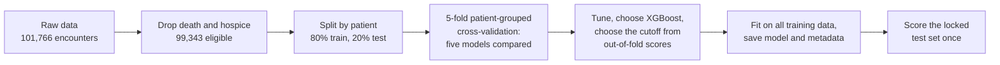
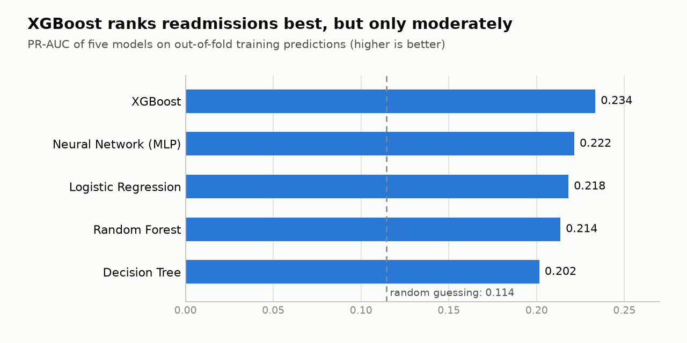
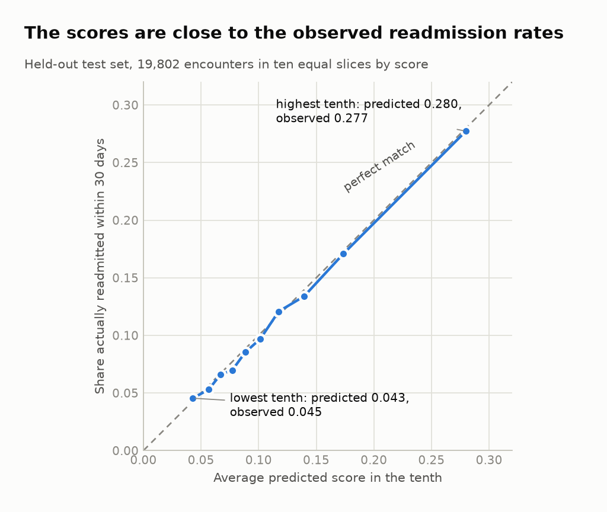
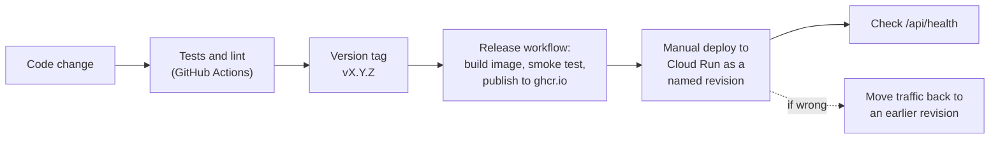

# Project report: predicting 30-day readmission for diabetic inpatients

A retrospective engineering prototype, written in November 2026 and covering version 0.2.1. It is a learning project and **not a clinically validated tool**: it must not be used to decide who receives care. The [README](../README.md) is the reference for running the code, and the [model card](model_card.md) is the formal statement of what the model is and is not for. This report tells the story from question to live service.

## 1. Summary

**The question.** Given what is known about a diabetic patient's hospital stay at discharge, how likely is a readmission within 30 days? A care-coordination team could use such a ranking to decide whom to call first.

**The answer, in four numbers.** On 19,802 held-out encounters from patients the model never saw, XGBoost ranks readmissions better than chance but only moderately:

| ROC-AUC | Share of encounters flagged | Of those flagged, truly readmitted | Of all readmissions, found |
|---|---|---|---|
| 0.676 (0.660 to 0.690) | 24.4% | 21.0% (19.4% to 22.3%) | 45.9% (43.0% to 48.5%) |

Flagging the 10% highest-scored encounters finds readmissions about 2.5 times as often as picking at random (2.27 to 2.68). Brackets are 95% intervals from resampling patients.

**What was built.** A reproducible and tested Python package, a web page that scores one encounter or a small CSV, a Docker image published by a tagged release, and a live demonstration on Google Cloud Run with usage totals, a notice mode and a rehearsed rollback: <https://readmission-app-364492331058.us-central1.run.app>

**What it is not.** The data is from 1999 to 2008, the signal in it is modest, performance differs between groups of patients, and nothing here has been clinically validated.

## 2. The problem and the data

The data is the public *Diabetes 130-US Hospitals for Years 1999-2008* dataset (Clore et al., 2014): 101,766 inpatient encounters with 50 columns. Encounters that ended in death or hospice discharge were excluded, because those patients cannot be readmitted, which leaves 99,343. The target is 1 if the patient was readmitted in under 30 days and 0 otherwise.

Two facts shape almost every decision:

- **Positives are rare.** Only about 11.4% of encounters are readmitted within 30 days. Predicting "not readmitted" for everyone is 88.6% accurate, so accuracy tells almost nothing. The comparison uses ranking measures (ROC-AUC, and PR-AUC, where random guessing scores 0.114) and what a team with limited capacity would see (precision and lift among the top 10%).
- **Patients repeat.** One patient can appear in several encounters. If the same patient were in both the training and test data, the test would flatter the model. Everything that splits or resamples data, including cross-validation and the confidence intervals, moves whole patients together.

## 3. How the model was built

- **Five models** were compared on identical folds: logistic regression, decision tree, random forest, XGBoost and a small neural network. Each is one pipeline (cleaning, encoding, model), so preprocessing is learned inside each training fold and never sees the validation rows.
- **Tuning** used grid search (30 random candidates for XGBoost) with patient-grouped cross-validation, selecting on PR-AUC. The winners are stored in a JSON file, not in code, so a re-run changes one file and git shows when.
- **The cutoff** (0.1405) is the score that maximizes F1 on out-of-fold training predictions. The usual 0.5 cutoff fails here: the tuned random forest never predicts above 0.3, so it would flag no one.
- **The test set stayed locked** until the model, settings and cutoff were fixed, and was scored once. Later analysis of the test set (below) only describes it and changes nothing.

## 4. Results

XGBoost is the strongest model, but the differences are small. Its lead over logistic regression is about 0.016 PR-AUC, roughly four times the fold-to-fold spread, so it is real but not large. The dataset carries limited predictive signal, and no model changes that.

**On the held-out test set** the figures agree closely with cross-validation (ROC-AUC 0.679 and PR-AUC 0.234 in cross-validation, against 0.676 and 0.236), so the choices do not look overfitted. The intervals are in the summary above. The full table is in the [model card](model_card.md).

**Calibration.** In each tenth of the test set, ordered by score, the average score is close to the share really readmitted. Across all encounters the average score is 0.114 against 0.112 observed. The scores are therefore approximately calibrated on this split. That was checked once and in tenths only, so the web page still calls the result a ranking score and not an exact chance.

**Groups.** The model does not perform the same for every kind of patient. Highlights from the test set (group figures have no intervals of their own, and small groups are noisy):

| Group | Encounters | Flagged | Found (recall) | ROC-AUC |
|---|---|---|---|---|
| Ages 50 to 60 | 3,469 | 18.1% | 46.3% | 0.713 |
| Ages 80 to 90 | 3,287 | 30.8% | 46.2% | 0.644 |
| Women | 10,645 | 25.9% | 48.1% | 0.682 |
| Men | 9,157 | 22.7% | 43.3% | 0.669 |
| Caucasian | 14,886 | 24.7% | 45.9% | 0.673 |
| African American | 3,707 | 25.7% | 47.2% | 0.672 |
| Race not recorded | 418 | 12.7% | 23.7% | 0.650 |

The model flags older patients more often, and its ranking gets worse with age (ROC-AUC 0.535 at 90 and over). Race is similar for the two largest groups, but encounters with no recorded race are flagged and found much less often, from only 38 readmissions. This is a description and not a fairness audit: no cause was investigated and nothing was adjusted. The complete numbers are in [`reports/test_analysis.json`](../reports/test_analysis.json).

## 5. From a notebook to a live service

The first model was found in a notebook. The package, web app and operations were then built step by step, each reviewed before it was committed.

- **Package and tests.** The code lives in an installable package with 111 automated tests that need no real data (they run on synthetic encounters), plus lint. Every push runs them on a clean machine.
- **Web app.** One page scores a single encounter from a form or up to 10 rows from a CSV. Inputs are validated field by field, and error messages name the column but never repeat what was typed. The page asks users not to enter real patient information.
- **Privacy by design.** Requests are scored in memory and nothing is stored. The app logs no request data and its responses omit the inputs. The one log line names the kind of an unexpected error and never its message, which could contain submitted values. Tests check these properties. The hosting platform keeps its own request log (time, visitor address, browser and result code), which the app cannot switch off, and the model card says so.
- **Docker image.** The app and the model are packaged together (about 160 MB compressed), run as an ordinary user and use the CPU-only XGBoost build. Committing the model file means a release is one exact code-and-model pair.
- **Releases.** Pushing a tag such as `v0.2.1` starts a workflow that checks the tag matches the version in the code, builds the image, starts it, scores a sample and only then publishes it to GitHub's container registry. The version is written in one place only.
- **Hosting.** Google Cloud Run runs the image with one instance at most, none when idle, a 30-second request limit and a budget alert. The first visit after a quiet period takes about 5 to 8 seconds while a container starts, measured twice; later requests take about 0.13 seconds.
- **Operating it.** `/api/health` reports the running version, `/api/stats` shows running totals (encounters scored, share flagged, rejected inputs, errors) with nothing per visitor, and a notice mode shows a statement instead of the form. A rollback, notice mode and taking the service offline were each tried once on the live service, and the commands are in the [README](../README.md).

## 6. Limits and what it must not be used for

- **Not a clinical tool.** It must not be used to decide who receives care or treatment.
- **Old data.** The encounters are from 1999 to 2008. Practice, coding and populations have changed.
- **Modest signal.** ROC-AUC of 0.68 means many readmissions are missed and many flags are wrong: about four in five flagged encounters are not readmitted.
- **Only readmissions in the same data are seen.** Returns to other hospitals are not captured.
- **Group differences exist and are not explained by this study.**
- **Association, not causation.** Patterns in the inputs do not mean that changing an input changes the outcome.
- **A demonstration service.** It runs on a small budget, may be paused or taken down, and has no per-visitor rate limiting (the instance cap and request limit bound what a flood can do).

## 7. Lessons learned

- **A first publish has failure modes that later releases never meet.** The first image push to the registry was refused until the package's permissions were set and the failed job was re-run. Those settings are touched only once, so the first release is worth rehearsing early.
- **A privacy design has to hold in the server's logs, not only in the app's code.** The app was designed to keep nothing about what users enter, but the server around it writes logs of its own. Starlette re-raises an error after a custom handler runs, and uvicorn then logs the whole traceback, including the error message, which can contain submitted values. The fix was to answer errors inside the middleware and log only the kind of error. It was checked against a real server, because the test client does not log.
- **Design the service to need little maintenance.** It scales to zero when idle, is capped at one instance with a request time limit, and has a notice mode and a rollback that each take one command. The version is written in one place, and every release is a tested, tagged image. Fewer moving parts and quick ways to undo a change leave little to look after and little that can go wrong.

The project was developed with [Claude Code](https://claude.com/claude-code), working with the repository owner. Each phase was reviewed and approved by the owner before it was committed.

## 8. Potential Next Steps

- **A proper fairness review**, with intervals for each group, an investigation of the age pattern and of the missing-race group, and a decision about acceptable differences.
- **Check the scores on other splits and years**, since calibration was verified on one split of one period.
- **Choose the cutoff from capacity and cost** (how many calls a team can make) instead of F1.
- **Explain individual scores**, so a user can see what pushed a score up.
- **Newer data and clinical review**, which any real use would need first.
- **Alerts** on error counts, and per-visitor rate limiting, if the demo is kept running for longer.

## 9. Where to find things

| What | Where |
|---|---|
| Running the code and the operations runbook | [README](../README.md) |
| What the model is for and its limits | [Model card](model_card.md) |
| Data source and attribution | [`data/README.md`](../data/README.md) |
| Comparison table, tuned settings, test-set analysis | [`reports/`](../reports/) |
| The figures above | `python scripts/make_figures.py` |
| Test-set intervals, groups and calibration | `python -m readmission.analyze` |

## References

Clore, J., Cios, K., DeShazo, J., & Strack, B. (2014). Diabetes 130-US Hospitals for Years 1999-2008 [Dataset]. UCI Machine Learning Repository. https://doi.org/10.24432/C5230J

Strack, B., DeShazo, J. P., Gennings, C., Olmo, J. L., Ventura, S., Cios, K. J., & Clore, J. N. (2014). Impact of HbA1c measurement on hospital readmission rates: Analysis of 70,000 clinical database patient records. BioMed Research International, 2014, Article 781670. https://doi.org/10.1155/2014/781670
